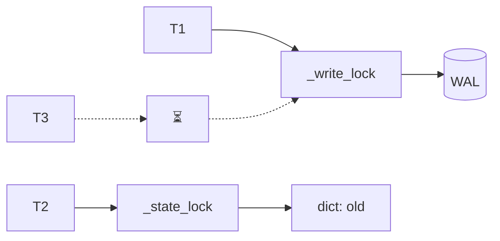
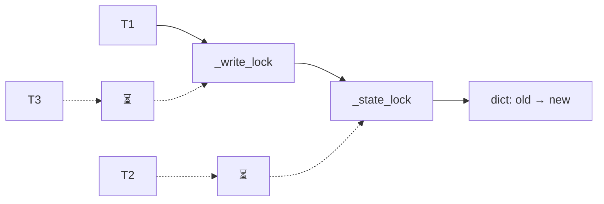
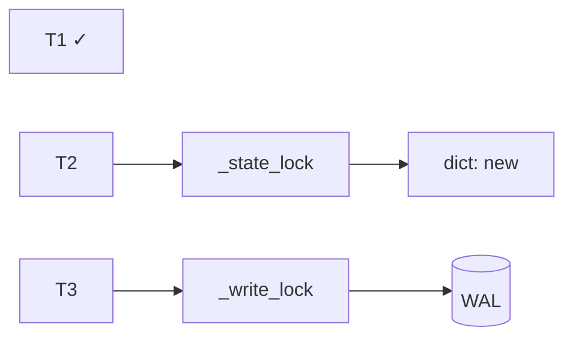

# Конкурентный доступ к KVDB

Несколько потоков могут обращаться к одному общему экземпляру `KVEngine`.
Движок должен сохранять одинаковый порядок изменений в WAL и словаре,
позволяя чтениям продолжаться во время дисковых операций. Для этого запись
выполняется последовательно, а доступ к памяти блокируется лишь на короткое время.

## Устройство блокировок

| Блокировка | Назначение | Кто использует |
|---|---|---|
| `_write_lock` | Упорядочивает полный цикл изменения и сохранения данных, включая работу с диском | `set`, `delete`, `flush`, `close` |
| `_state_lock` | Защищает словарь и флаги состояния при проверке, чтении, обновлении и копировании для снимка | Читатели и писатели |

Во время записи WAL писатель удерживает `_write_lock`, но освобождает
`_state_lock`: читатели могут получить текущее значение. При обновлении словаря
писатель удерживает обе блокировки, поэтому остальные обращения к памяти ждут.
Другие писатели ждут `_write_lock` на протяжении всей операции записи.

Обе блокировки эксклюзивные. Читатели тоже кратковременно выполняются по очереди
под `_state_lock`, но не ждут дисковой синхронизации. Если нужны обе блокировки,
порядок захвата всегда один: `_write_lock`, затем `_state_lock`.

`RLock` допускает повторный захват тем же потоком; это позволяет `close()`
вызвать `flush()` с повторным захватом `_write_lock`.

## Пример взаимодействия потоков

Три потока выбраны для демонстрации разных ролей; их количество в реализации
не ограничено тремя:

- `T1` выполняет `set(key, new)`.
- `T2` читает тот же ключ через `get(key)`.
- `T3` пытается выполнить следующую запись.

Изначально значение ключа — `old`. Схемы показывают один из возможных порядков
успешного выполнения операций на трёх этапах записи `T1`. На первом этапе
`T2` читает `old`, на втором делает новый вызов `get()`, который продолжается
после освобождения блокировки на третьем этапе.

На схемах `T1`–`T3` обозначают потоки, сплошная стрелка — доступ через
захваченную блокировку, пунктир с `⏳` — ожидание, `✓` — завершение операции.

### 1. Запись в WAL: чтение доступно

Поток 1 захватывает `_write_lock`, кратковременно проверяет состояние под
`_state_lock`, затем освобождает её и записывает операцию в WAL с `fsync`.
Словарь пока содержит `old`.

Поток 2 не ждёт диска: ему нужна только `_state_lock`. После чтения он
освобождает её. Поток 3 ждёт, чтобы записи в журнал и изменения памяти
выполнялись в одном порядке.

### 2. Обновление словаря: остальные потоки ждут

После успешной синхронизации WAL поток 1 захватывает `_state_lock` и заменяет
значение в словаре. `_write_lock` всё ещё удерживается. В этот момент поток 2
снова вызывает `get()` и ждёт освобождения `_state_lock`.

Читатели и другие писатели ждут по разным причинам. Читатели не могут
обращаться к словарю во время его изменения, а писатели ещё не могут начать
следующую операцию. Этот этап короткий: дисковых операций под `_state_lock` нет.

### 3. Освобождение блокировок: потоки продолжают работу

Поток 1 освобождает `_state_lock`, затем `_write_lock` и возвращает успех.
Читатель может получить `new`, а следующий писатель — начать свою запись в WAL.

Порядок пробуждения потоков не гарантирован. Читатель может продолжить уже
после освобождения `_state_lock`, а показанное значение `new` доступно до
следующего изменения словаря. Когда поток 3 перейдёт от WAL к обновлению
памяти, снова возникнет короткое ожидание, показанное на второй схеме.

## Сохранение, закрытие и границы синхронизации

`flush()` удерживает `_write_lock` на всём протяжении сохранения снимка и
очистки WAL. Под `_state_lock` он получает копию словаря, затем освобождает
её на время работы с диском. Читатели продолжают работать с памятью,
а новые изменения ждут завершения сохранения.

`close()` также исключает писателей. Чтения допустимы до перехода движка
в закрытое состояние; после этого операции запрещены.

Блокировки защищают отдельные операции. Последовательность `get()` и `set()`
не является атомарной транзакцией. Прямые обращения к `FileWAL` и `FileStorage`
во время работы движка обходят его синхронизацию и не поддерживаются.

Порядок сохранения и обработка ошибок описаны в
[обзоре реализации](implementation.md#сохранение-снимка), ограничения доступа
к каталогу базы — в [разделе ограничений](implementation.md#ограничения).
