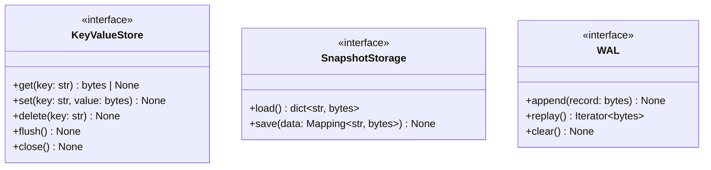
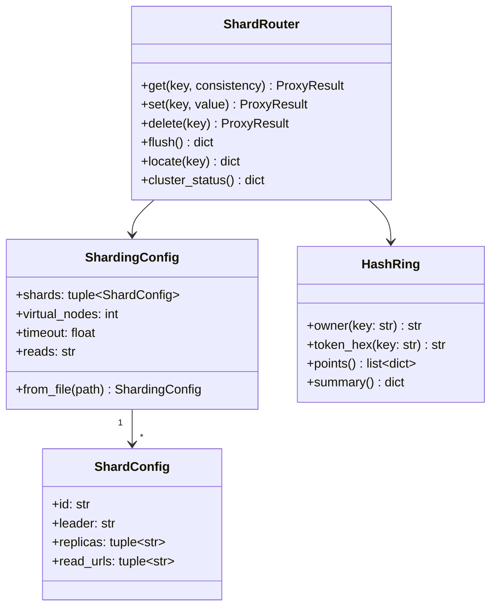

# Контракты базы

Движок зависит от интерфейсов хранилища снимка и WAL. Их роль в системе
описана в [архитектуре](implementation.md#архитектура), а использование
публичных операций — в [контракте API](implementation.md#модель-данных-и-api).

Роутер шардов не входит в контракт локального движка: он работает с узлами
по HTTP и не хранит данные. Его зависимости показаны отдельно.

Подробное описание и HTTP-контракт: [шардирование](sharding.md).
