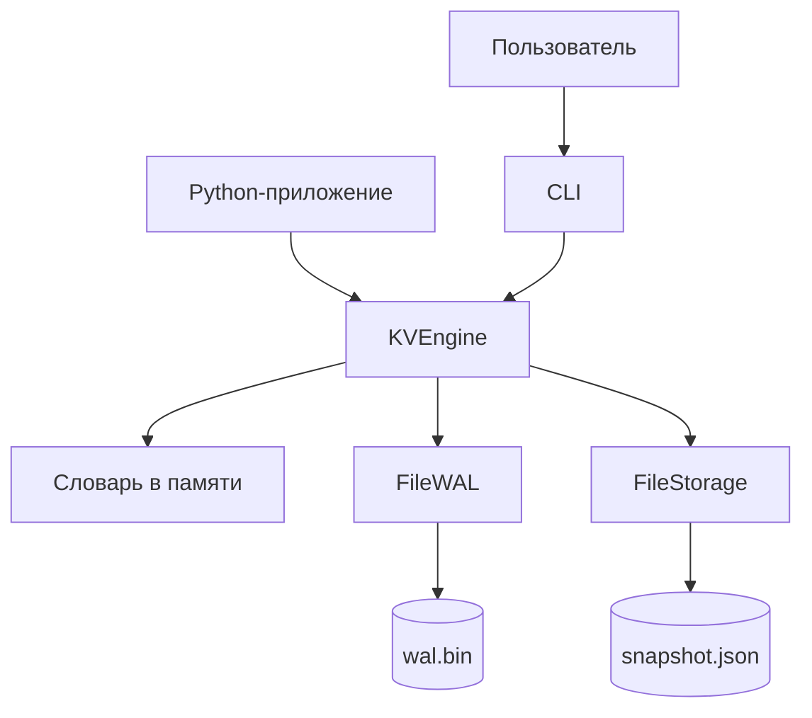
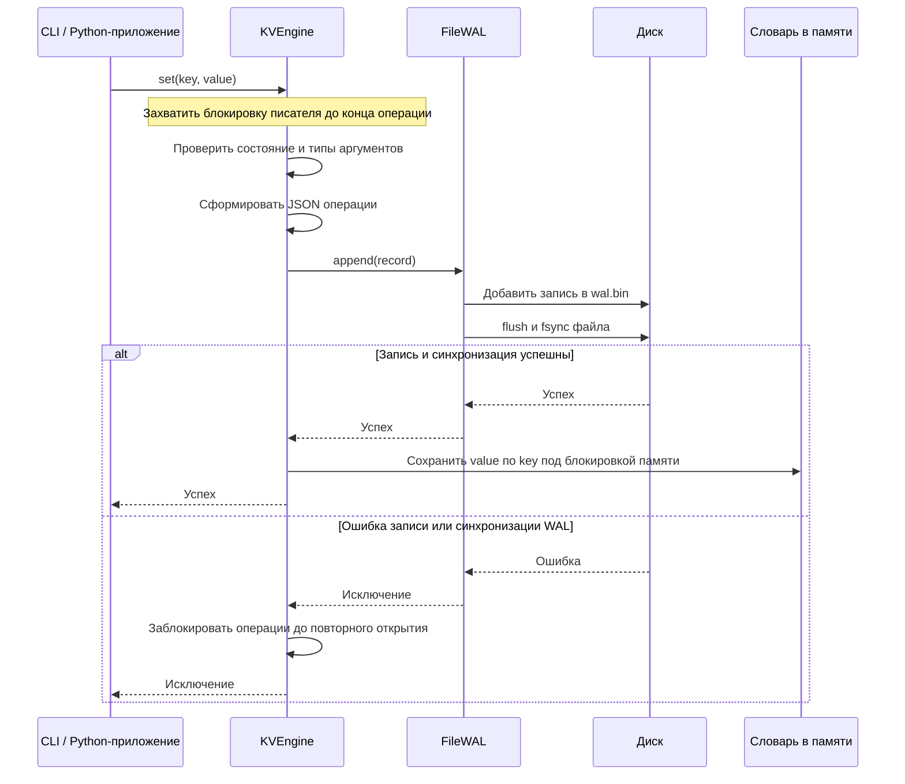
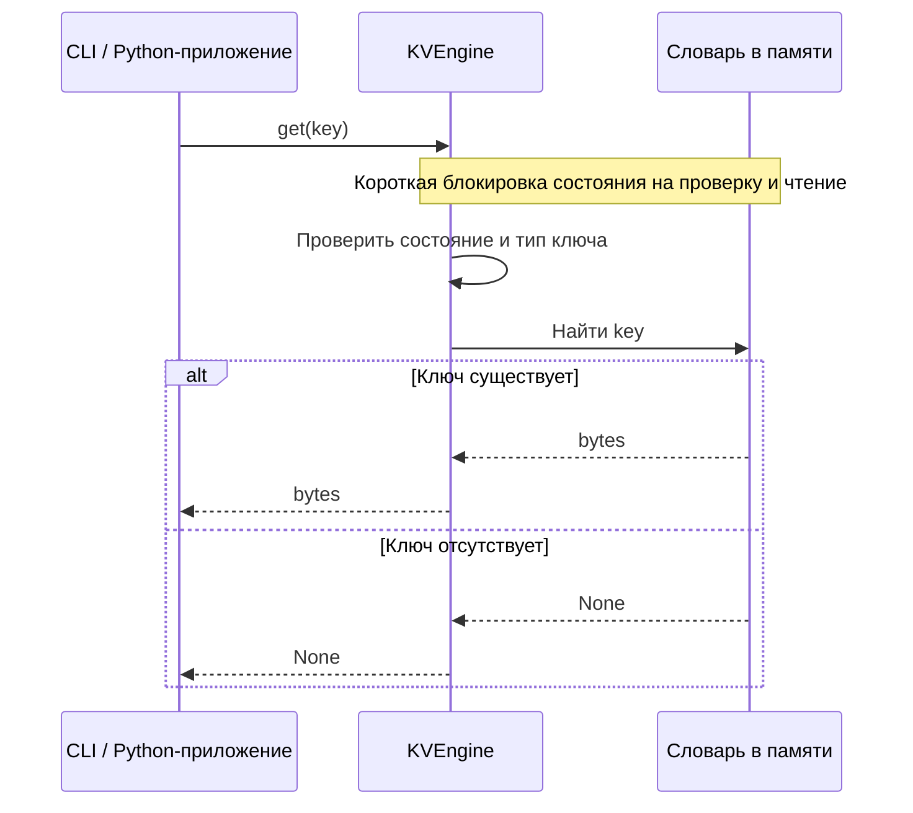

# Реализация KVDB

KVDB — локальная key-value база данных со строковыми ключами и байтовыми
значениями. Текущее состояние хранится в памяти, а изменения сохраняются на
диск через журнал операций (WAL). Снимок позволяет сохранить всё состояние
и сократить журнал. Документ описывает реализацию второй лабораторной работы.

## Архитектура

| Компонент | Ответственность | Реализация |
|---|---|---|
| CLI | Разбор команд, преобразование текстовых значений в UTF-8, вывод результатов | [main.py](../kvdb/cli/main.py) |
| Движок | Операции с данными, управление памятью, журналом и снимком | [engine.py](../kvdb/engine/engine.py) |
| Хранилище снимка | Загрузка и атомарное сохранение полного состояния | [file_storage.py](../kvdb/storage/file_storage.py) |
| Журнал операций | Сохранение изменений и их последовательное чтение при восстановлении | [file_wal.py](../kvdb/wal/file_wal.py) |
| Файловые операции | Создание каталогов и синхронизация их записей | [_files.py](../kvdb/_files.py) |

Движок реализует интерфейс `KeyValueStore` и принимает реализации интерфейсов
`SnapshotStorage` и `WAL`. Это отделяет операции базы от конкретного способа
хранения. Контракты представлены в [диаграмме интерфейсов](diagram.md).

## Модель данных и API

В памяти данные представлены словарём `dict[str, bytes]`.

| Операция | Результат |
|---|---|
| `get(key)` | Значение типа `bytes` или `None`, если ключ отсутствует |
| `set(key, value)` | Запись или замена значения |
| `delete(key)` | Удаление ключа; отсутствие ключа допустимо |
| `flush()` | Сохранение полного снимка и очистка WAL |
| `close()` | Сохранение состояния и закрытие движка |

Неверные типы ключей и значений вызывают `TypeError`. Пустые ключи и значения
допустимы. Повторный `close()` допустим, остальные операции после закрытия
вызывают `RuntimeError`. Контекстный менеджер вызывает закрытие и при исключении
внутри блока. Пример вызовов приведён в [README](../README.md#python-api).

## Запись данных

Движок сначала сохраняет операцию в WAL и только после успешной синхронизации
журнала обновляет память. Успешный возврат `set()` подтверждает синхронизацию
WAL; создание снимка для каждой записи не требуется.

`delete()` использует тот же порядок: запись операции удаления в WAL,
синхронизация, затем удаление ключа из памяти.

При ошибке WAL неизвестно, успела ли операция попасть на диск. Движок
блокирует дальнейшие операции, а `close()` пропускает сохранение снимка,
чтобы не записать устаревшее состояние памяти. После повторного открытия
операция, вернувшая ошибку, может оказаться восстановленной из журнала.

## Чтение данных

После открытия базы чтение выполняется из памяти. Обращения к снимку и WAL
для каждого запроса не нужны.

## Сохранение снимка

`flush()` переносит текущее состояние из памяти в снимок:

1. Движок получает копию словаря под блокировкой состояния. `FileStorage`
   сериализует её и записывает временный файл рядом со снимком.
2. Временный файл синхронизируется через `flush` и `fsync`.
3. Он атомарно заменяет `snapshot.json`, затем синхронизируется каталог.
4. Только после успешного сохранения снимка движок очищает и синхронизирует WAL.

Порядок защищает данные: журнал сохраняется до подтверждённого сохранения
снимка. Если программа завершится между сохранением снимка и очисткой WAL,
при следующем открытии журнал будет применён повторно. Полная последовательность
присваиваний и удалений приводит к тому же итоговому состоянию.

Ошибка до замены файла оставляет прежний снимок. Ошибка синхронизации каталога
после замены означает, что новый снимок уже может быть виден, но WAL ещё не
очищен. После ошибки сохранения снимка можно повторить `flush()`; после ошибки
очистки WAL требуется повторное открытие движка.

`close()` вызывает `flush()` и помечает движок закрытым; при блокировке после
ошибки WAL сохранение снимка пропускается. Правила повторных вызовов и поведение
контекстного менеджера описаны в [контракте API](#модель-данных-и-api).

## Конкурентный доступ

Изменения и сохранение выполняются последовательно под `_write_lock`.
Короткая блокировка `_state_lock` защищает данные в памяти, позволяя чтениям
продолжаться во время дисковых операций. Устройство блокировок и пример
взаимодействия потоков описаны в [документе о конкурентном доступе](concurrency.md).

## Открытие и восстановление

При создании `KVEngine` выполняются следующие шаги:

1. Загрузить снимок в словарь. Если снимка нет, начать с пустого состояния.
2. Прочитать записи WAL по порядку и проверить контрольные суммы.
3. Применить каждую операцию к словарю: `set` присваивает значение,
   `delete` удаляет ключ.
4. После завершения восстановления разрешить работу с базой.

Незавершённая последняя запись WAL обрезается до последней корректной границы
с синхронизацией файла. Повреждение контрольной суммы полной записи,
некорректная операция или повреждённый снимок вызывают ошибку открытия.

## Форматы хранения

| Файл | Содержимое |
|---|---|
| `snapshot.json` | JSON с версией формата и полным словарём; значения кодируются в Base64 |
| `wal.bin` | Записи вида: длина payload (4 байта), payload, CRC32 payload (4 байта) |

Числа в WAL записаны в big-endian. Payload содержит JSON операции `set` или
`delete`; байтовое значение операции `set` представлено в Base64. CRC32 служит
для обнаружения повреждений payload.

## Ограничения

Все данные должны помещаться в оперативную память. С одним каталогом базы
может работать только один экземпляр движка в одном процессе. Отдельные
экземпляры не разделяют блокировки и словарь; межпроцессные блокировки не
реализованы. Сохранение снимка обрабатывает весь словарь, а WAL растёт
до следующего `flush()` или успешного закрытия.

Файловая реализация использует `os.O_DIRECTORY` и синхронизацию каталогов.
Она рассчитана на Linux/POSIX с поддержкой `fsync` файлов и каталогов;
нативная работа на Windows не поддерживается.

Команды запуска и примеры использования приведены в [README](../README.md),
сценарии и границы проверок — в [матрице тестов](testing/matrix.md).
