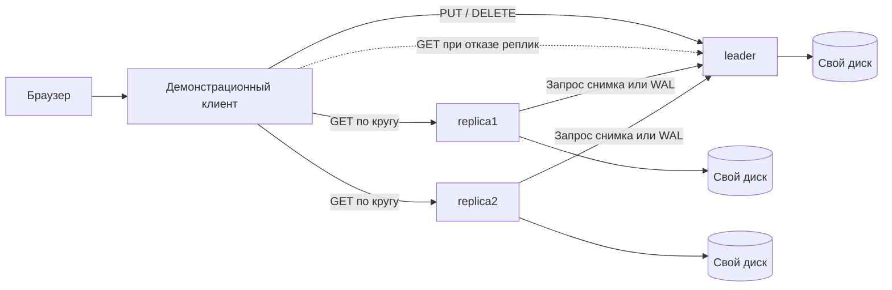
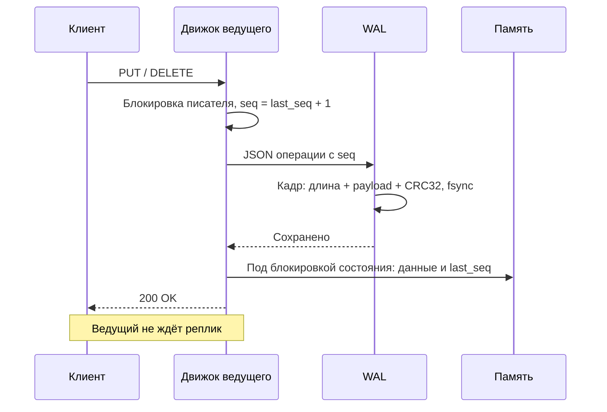
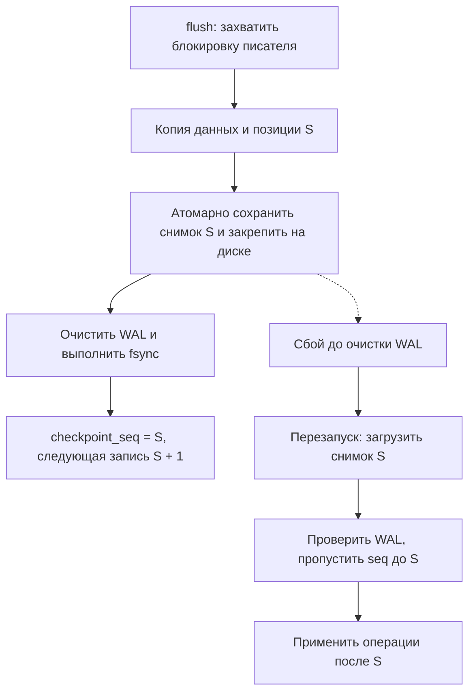
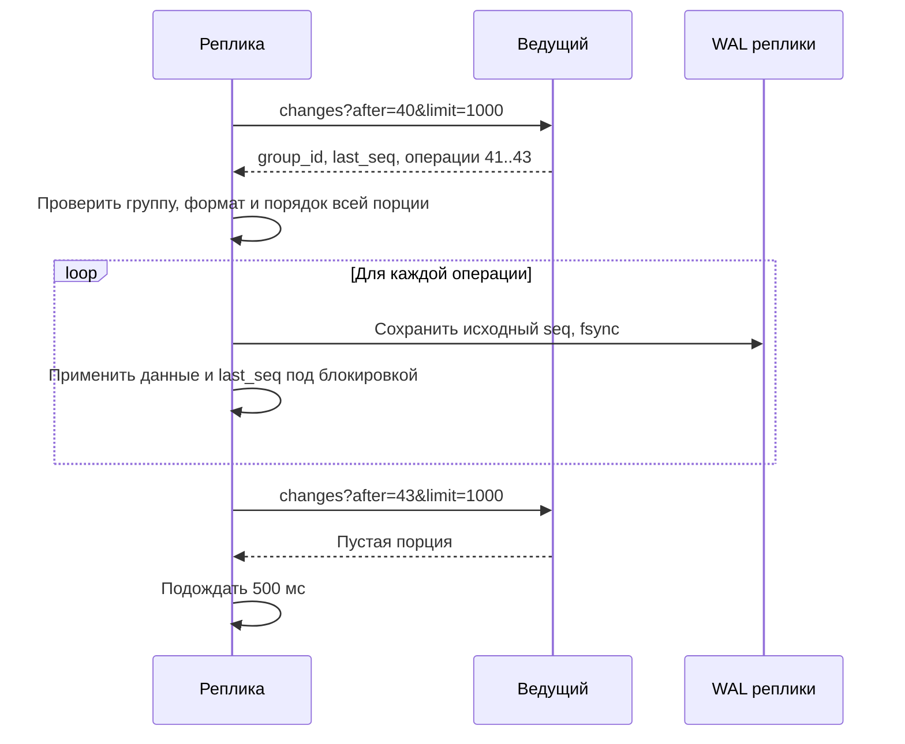
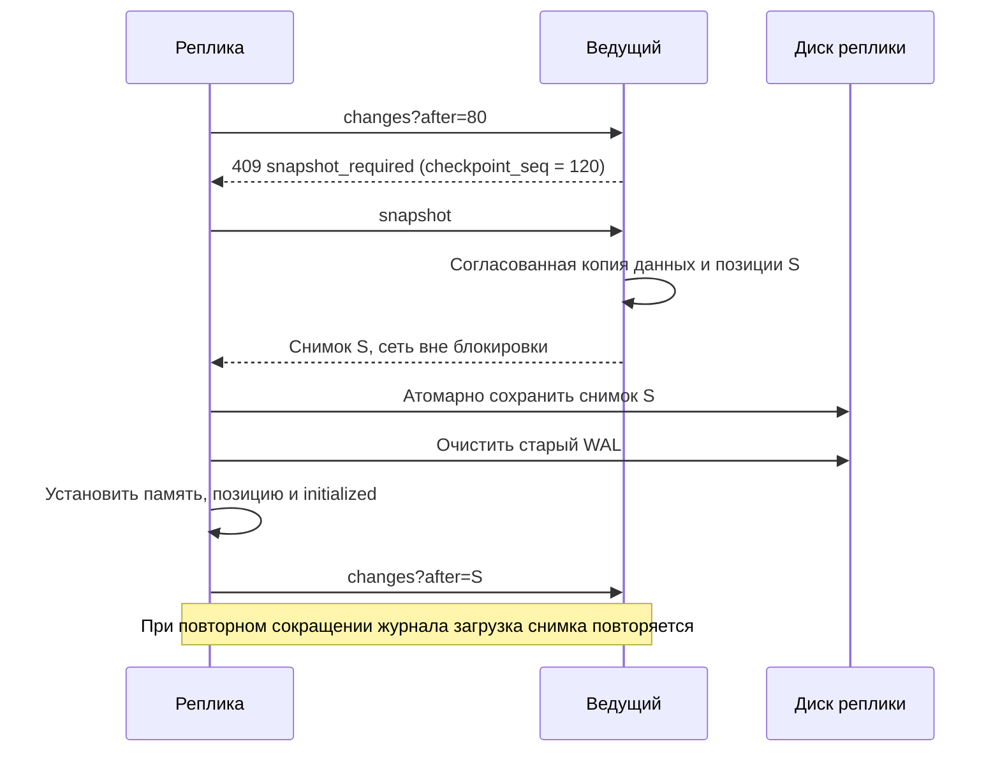
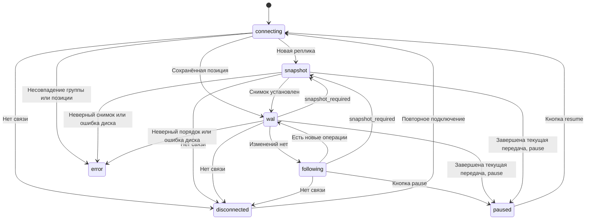

# Репликация KVDB

Репликация поддерживает копии данных на нескольких узлах. Документ описывает
роли узлов, передачу операций через WAL, восстановление, управление
синхронизацией и запуск кластера. Локальное хранение описано
в [обзоре реализации](implementation.md), проверки — в [матрице тестов](testing/matrix.md).

## Архитектура и гарантии

Кластер содержит одного ведущего и произвольное число реплик. Ведущий принимает
изменения, а реплики периодически забирают его WAL. Каждый узел использует
собственные снимок и WAL. Репликация асинхронная: успешный `PUT/DELETE`
подтверждает `fsync` на ведущем, но не получение данных репликами.



Реплика может вернуть старое значение или `404` сразу после записи на ведущем.
Чтение собственных записей обеспечивается обращением к ведущему. При потере
связи инициализированная реплика продолжает локальные чтения. Если ведущий
недоступен, изменения не принимаются; автоматического выбора нового ведущего нет.
Безвозвратная потеря диска ведущего может уничтожить подтверждённые, но ещё
не переданные изменения. Один Docker-хост демонстрирует отказы процессов,
а не устойчивость к потере машины.

## Запись, WAL и позиции

Каждая операция ведущего получает строго возрастающий `seq` под блокировкой
писателя. `seq` — логический номер, а не время. Каждая группа репликации,
в том числе будущий шард, имеет собственную последовательность.



Примеры payload WAL:

```json
{"seq":1,"op":"set","key":"hello","value":"d29ybGQ="}
{"seq":2,"op":"delete","key":"hello"}
```

Физический формат WAL остаётся прежним: длина uint32, payload, CRC32 uint32,
оба числа big-endian. Повреждение CRC вызывает ошибку; неполный хвост после
сбоя отрезается существующим механизмом восстановления.

`FileWAL` остаётся хранилищем байтовых записей. Семантику JSON проверяет
`Operation`. `ReplicatedEngine` расширяет локальный движок, сохраняя его
публичный контракт. Standalone использует прежний WAL без `seq` и снимок v1.

## Снимки и восстановление

Кластерный снимок v2 содержит всю необходимую позицию в одном файле:

```json
{
  "version": 2,
  "group_id": "lab4",
  "last_seq": 120,
  "initialized": true,
  "data": {"hello": "d29ybGQ="}
}
```

Снимок записывается во временный файл, закрепляется через `fsync`, атомарно
заменяет основной файл; затем закрепляется каталог. Метаданные не хранятся
отдельным файлом. У новой реплики сначала сохраняется пустой снимок с
`initialized=false`; у ведущего — `true`. Это закрепляет группу до первой
операции и отличает пустую готовую базу от ещё не загруженной.

На старте узел проверяет группу, загружает снимок, проверяет WAL и применяет
только операции после `last_seq`. Пропуск последовательности блокирует запуск.
Кластерный каталог нельзя открыть как standalone или с другой группой.
Преобразование старой базы в кластер не реализовано: используйте новые каталоги.
Смена роли не является поддерживаемым протоколом failover.



При ошибках сохранения/очистки движок блокируется до повторного открытия.
Его `close()` не записывает потенциально устаревшую память поверх дисковых данных.
Штатное закрытие сохраняет снимок и сокращает WAL.

## Синхронизация реплики

У реплики работает один фоновый поток с HTTP-клиентом. Если реплика ещё не
инициализирована, он загружает снимок. После перезапуска готовая реплика сначала
пытается продолжить WAL со своей позиции. Порции по 1000 операций читаются
без паузы, пока есть изменения; при отсутствии изменений или потере связи
пауза по умолчанию 500 мс. Тайм-аут запроса — 2 с.



Движок пропускает повторную доставку уже применённой операции, принимает
следующий номер и отклоняет пропуск. Рабочий поток дополнительно проверяет
непрерывность всей порции до начала её применения.



Установка снимка не может откатить позицию реплики назад. Неизвестная группа,
позиция впереди ведущего или неверная последовательность приводят к состоянию
`error`; требуется диагностика и перезапуск после устранения причины.
Сетевые ошибки повторяются автоматически. При постоянных интенсивных записях
и частом `flush` возможно повторное скачивание снимков; удержание истории по
позициям реплик не входит в учебную реализацию.



## HTTP API и диагностика

| Метод | Результат |
|---|---|
| `GET /health` | Жив HTTP-сервер; не гарантия готовности реплики |
| `GET /replication/status` | Роль, группа, готовность, позиции; на реплике — состояние потока и ошибки |
| `GET /internal/replication/status` | Статус ведущего |
| `GET /internal/replication/changes?after=S&limit=N` | Статус ведущего и массив `operations`; `1 ≤ N ≤ 1000` |
| `GET /internal/replication/snapshot` | Снимок v2 |
| `POST /flush` | Только локальное сохранение узла |

`checkpoint_seq` — позиция последнего сохранённого снимка, до которой журнал
можно считать сокращённым. `changes` для более старой позиции возвращает
`409 {"code":"snapshot_required"}`, для позиции впереди ведущего —
`409 {"code":"position_ahead"}`. Некорректные параметры — `422`.
Внутренние методы выдачи данных доступны только ведущему; на других ролях — `403`.
До первого снимка реплика отвечает на чтение `503`, на клиентские изменения —
`403`. После начальной загрузки чтение не зависит от текущей связи с ведущим.

Поля статуса реплики:

- `state`: `connecting`, `snapshot`, `wal`, `following`, `paused`, `disconnected`, `error`;
- `paused`: включена ли управляемая пауза синхронизации;
- `last_seq`, `leader_last_seq`, `lag`: локальная и последняя известная позиции;
- `last_contact`, `lag_stale`, `last_error`: свежесть оценки и диагностика;
- `wal_operations`, `snapshots_installed`, `last_transfer`: счётчики текущего
  процесса и последний способ восстановления; после перезапуска счётчики обнуляются.

Внутренний API рассчитан на доверенную учебную сеть, без авторизации.
Docker публикует порты только на loopback хоста.

## Блокировки и остановка

Порядок блокировок: `_write_lock`, затем `_state_lock`. Дисковые и сетевые
операции не удерживают блокировку памяти, кроме краткой фиксации состояния.
Чтение истории, изменение и очистка WAL упорядочены блокировкой писателя.
Копия снимка получается под блокировкой состояния, сериализация выполняется после неё.

HTTP-сервер и CLI удерживают POSIX-блокировку `.lock` на весь срок работы.
Используется один worker. При прямом использовании Python API ответственность
за исключительный доступ к каталогу остаётся у вызывающей стороны.
При остановке HTTP-сервера сначала завершается поток репликации, затем сохраняется
и закрывается движок, в конце освобождается блокировка каталога.

## Запуск

```bash
# Standalone, старое поведение
python -m kvdb.http --data-dir ./data/local --port 8000

python -m kvdb.http --role leader --group-id lab4 \
  --data-dir ./data/leader --port 8000

python -m kvdb.http --role replica --group-id lab4 \
  --leader-url http://127.0.0.1:8000 --data-dir ./data/replica1 --port 8001

python -m kvdb.http --role replica --group-id lab4 \
  --leader-url http://127.0.0.1:8000 --data-dir ./data/replica2 --port 8002

# Веб-интерфейс; нагрузка запускается кнопкой
python -m kvdb.web --leader-url http://127.0.0.1:8000 \
  --replica-urls http://127.0.0.1:8001 http://127.0.0.1:8002
```

Параметры узла: `--role`, `--group-id`, `--leader-url`,
`--replication-interval` (0.5), `--replication-timeout` (2),
`--host`, `--port`, `--data-dir`. URL ведущего задаётся как HTTP(S) origin.
Для роли `replica` обязательны группа и ведущий; для `leader` — группа.

## Демонстрация в Docker Compose

```bash
mkdir -p reports/demo
docker compose up --build -d
docker compose ps
docker compose logs -f web
```

Открыть **http://localhost:8080**. Порты узлов: 8000, 8001, 8002. Внутри сети
ведущий доступен как `http://leader:8000`. У каждого узла отдельный постоянный
volume; web пишет JSONL на хост в `reports/demo/<run_id>.jsonl`.
Порядок запуска сервисов произвольный: реплики и клиент повторяют подключения.

Клиент создаёт постоянный контрольный ключ и ждёт его появления на всех узлах.
Веб-интерфейс по умолчанию оставляет нагрузку на паузе. Нажмите «Запустить
нагрузку»: три пользователя параллельно обновляют постоянные счётчики
`user-N`, читают их, затем выполняют `PUT → GET → DELETE → GET` на временных
ключах `user-N-temp`. Пауза между операциями — 1 с. Число пользователей и пауза настраиваются
через `--users`, `--interval`. Значение основного ключа — читаемый номер цикла. При перезапуске интерфейса
счётчик продолжается с прочитанного значения ведущего. Эти имена используются
демонстрационной нагрузкой; для ручных запросов выбирайте другие ключи. Начальная загрузка ждёт все реплики: сначала дождитесь готовности
стенда, затем начинайте отключения.

Чтения идут по кругу между репликами; при сетевой ошибке или `503` клиент
пробует следующую реплику, затем ведущего. `404` — корректный конечный ответ,
а не основание переключаться. Изменения не перенаправляются на реплики.
Транспортная ошибка или серверная ошибка изменения помечает результат как
неизвестный; повторного выполнения нет. Чтения могут задерживаться на тайм-аут
недоступного узла. Контрольный ключ читается независимо от пользователей.

Панель показывает узлы, готовность, позиции, график последних пяти минут,
счётчики передачи WAL/снимков, контрольное чтение и фильтруемую ленту.
Красный счётчик чтений включает неудачные попытки до успешного переключения;
доступность чтения оценивайте также по результату контрольного ключа.
После потери ведущего оценка отставания помечается устаревшей. Пауза останавливает
пользовательскую нагрузку; мониторинг и контрольное чтение продолжаются.

### Сценарий отказов

1. Нажать «Запустить нагрузку», дождаться надписи «Нагрузка активна».
   На карточке `replica1` нажать «Приостановить синхронизацию». Значение
   `last_seq` реплики застынет, отставание WAL начнёт расти, а в таблице
   счётчиков появятся разные значения. Реплика остаётся доступна для чтения.
   Нажать «Возобновить синхронизацию» и показать выравнивание значений.
2. Выполнить `docker compose stop replica1`. Ведущий принимает изменения,
   контрольное чтение переключается на другой узел.
3. Через несколько циклов выполнить `docker compose start replica1`.
   Не выполнять `flush` ведущего между шагами 2–3. У реплики увеличится
   `wal_operations`, а позиции сойдутся.
4. Снова выполнить `docker compose stop replica1`, дождаться новых записей.
   Нажать «Снимок + очистить WAL лидера», затем `docker compose start replica1`.
   Показать увеличение `snapshots_installed` и восстановление позиции.
5. Выполнить `docker compose stop leader`. Изменения показывают ошибки,
   контрольное чтение продолжает получать `200` от реплик.
6. Выполнить `docker compose start leader`. Изменения возобновляются;
   реплики догоняют ведущего. После штатного `stop` возможна загрузка снимка,
   поскольку `close()` сокращает WAL.
7. Повторить шаги 5–6 с `docker compose kill leader` вместо `stop`.
   Ведущий восстанавливается из снимка и WAL без штатного закрытия.
8. При работающем ведущем выполнить `docker compose stop replica1 replica2`.
   Показать чтение с ведущего. Затем `docker compose start replica1 replica2`.
9. Нажать «Проверить сходимость». Клиент приостановит пользователей, дождётся
   завершения запросов, зафиксирует снимок ведущего и в течение 30 с проверит
   позиции, контрольную запись и состояние всех затронутых ключей на каждом узле.
   Итог — `PASS` или конкретная причина незавершённой проверки.
10. Для продолжения нажать «Запустить».

Не выполняйте сторонние изменения во время проверки сходимости: изменение
зафиксированной позиции завершит её ошибкой. Число ключей обычной нагрузки не растёт по циклам: пользователи переиспользуют
свои ключи. Большое число разных ручных ключей может увеличить время проверки
до ограничения 30 с. Нагрузка после проверки остаётся на паузе.

```bash
# Остановка стенда с сохранением данных
docker compose down

# Новый запуск только клиента; создаст новый run_id
docker compose restart web
```

Снимки и WAL доступны в Docker volumes, а не в общих bind-каталогах узлов.
Проверка является самостоятельным сценарием веб-интерфейса и не использует pytest.
Модульные регрессионные проверки хранения и протокола находятся в
`tests/test_replication.py`; они дополняют демонстрацию.

## Веб-интерфейс базы и управляемая пауза

`web` — обычный сервис Compose, доступный на http://localhost:8080 при
`docker compose up --build -d`. Он объединяет мониторинг, ручные HTTP-запросы
и необязательную тестовую нагрузку. Запуск без Docker: `python -m kvdb.web`.
Нагрузка по умолчанию выключена; `--autostart` включает её при запуске.
Старый `python -m kvdb.demo` остаётся совместимым запуском с автозапуском нагрузки.
Маршрутизация запросов по шардам пока не реализована.

Кнопка на каждой карточке реплики вызывает через web-сервис
`POST /internal/replication/pause` или `POST /internal/replication/resume`.
На ведущем эти операции возвращают 403. Пауза ждёт завершения текущей передачи:
после ответа операции и снимки больше не применяются. Опрос позиции ведущего
продолжается, поэтому отставание обновляется. Чтения и локальный flush работают.
Пауза хранится в памяти и сбрасывается после перезапуска узла. Она отличается
от паузы пользовательской нагрузки, которая не останавливает репликацию.

Таблица показывает значения счётчиков по узлам. Жёлтым выделяется отличие от
последнего опроса ведущего; при потере связи показывается последнее известное
значение. Это отдельные HTTP-чтения с периодом около секунды, не атомарный
снимок всего кластера. Проверка сходимости остаётся способом строгой проверки
при остановленной нагрузке; перед ней возобновите синхронизацию реплик.

В журнале PUT выводится отправленное значение, GET — полученное. Base64
декодируется в UTF-8, бинарные данные обозначаются отдельно. Консольный журнал
также показывает читаемые значения; JSONL сохраняет исходное представление API.
Форма ручного запроса позволяет выбрать узел и выполнить PUT/GET/DELETE с
текстовым значением. Сырые данные API базы по-прежнему передаются в Base64.
