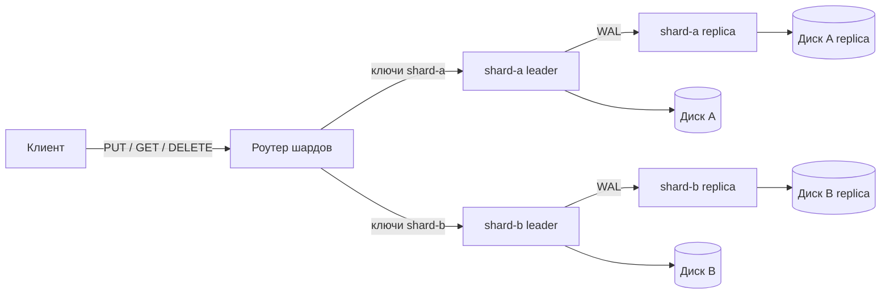

# Шардирование KVDB

Шардирование распределяет ключи между независимыми группами репликации.
Клиент работает с одним HTTP-адресом роутера и не знает, на каком шарде
хранится ключ. Роутер выбирает шард по кольцу consistent hashing, отправляет
изменения ведущему, а чтения распределяет по репликам. Локальное хранение
описано в [обзоре реализации](implementation.md), репликация — в
[отдельном документе](replication.md).

## Архитектура

Шард — это самостоятельная группа репликации со своими ведущим, репликами,
снимком, WAL и последовательностью `seq`. Группы не обмениваются операциями
и не образуют общий журнал. Роутер не хранит данные: он выполняет только
маршрутизацию и диагностические запросы.



Компоненты:

| Компонент | Ответственность | Реализация |
|---|---|---|
| `kvdb.sharding` | HTTP-роутер, единый API, коды ответов | [server.py](../kvdb/sharding/server.py) |
| `ShardRouter` | Выбор шарда, проксирование, отказоустойчивое чтение, статистика | [router.py](../kvdb/sharding/router.py) |
| `HashRing` | Кольцо виртуальных узлов и стабильное отображение ключа в шард | [ring.py](../kvdb/sharding/ring.py) |
| `ShardingConfig` | Проверка JSON-топологии и параметров маршрутизации | [config.py](../kvdb/sharding/config.py) |

Каждый шард можно запускать в режимах `leader` и `replica` из
[документа о репликации](replication.md). Роутер не требует, чтобы у шарда
были реплики, но при их наличии использует их для чтения.

## Кольцо consistent hashing

Отображение ключа в шард детерминировано и не зависит от порядка шардов
в конфигурации:

1. Для каждого шарда создаются `virtual_nodes` точек (по умолчанию 128).
   Точка вычисляется как `SHA-256("shard:<id>:<номер>")` и интерпретируется
   как 256-битное целое.
2. Ключ хешируется как `SHA-256("key:<key>")`.
3. В отсортированном кольце выбирается первая точка с позицией не меньше
   хеша ключа; если такой нет, берётся первая точка кольца.

Виртуальные узлы выравнивают нагрузку: у одного шарда много небольших
диапазонов, а не один непрерывный. При добавлении шарда часть диапазонов
переходит только к нему, остальные ключи сохраняют владельца. При удалении
шарда перераспределяются только его диапазоны. Это свойство проверяется
автотестами.

Посмотреть кольцо можно через `GET /sharding/ring`, а позицию конкретного
ключа — через `GET /sharding/locate/{key}`:

```json
{
  "key": "user-1",
  "shard_id": "shard-b",
  "token": "7d1e...",
  "leader": "http://shard-b-leader:8000",
  "replicas": ["http://shard-b-replica:8000"],
  "read_urls": ["http://shard-b-replica:8000"]
}
```

Хеш стабилен между перезапусками и хостами. Меняется только алгоритм
`consistent-hash-sha256`, версия которого указана в `/sharding/status`.

## Маршрутизация запросов

| Операция | Куда идёт запрос | Поведение при ошибке |
|---|---|---|
| `PUT /kv/{key}` | Ведущий выбранного шарда | Сетевой сбой — `503`; ответ узла возвращается как есть |
| `DELETE /kv/{key}` | Ведущий выбранного шарда | То же; автоматического повтора нет |
| `GET /kv/{key}` | Реплики по кругу, затем ведущий | Сеть и `5xx` — следующая попытка; `404` — окончательный ответ |
| `POST /flush` | Все ведущие параллельно | `200`, только если снимок сохранили все шарды, иначе `503` |
| `GET /sharding/status` | Опрос `/replication/status` всех узлов | Недоступный узел отражается в ответе, сам запрос завершается `200` |

Записи не повторяются при неопределённом результате: повторный `PUT`
идемпотентен по значению, но повторный `DELETE` или запись с другим значением
могли бы изменить порядок операций. Клиент получает `503` и сам решает,
повторять ли операцию.

Чтения по умолчанию идут на реплики, поэтому возможна согласованность
в конечном счёте: сразу после записи реплика может вернуть старое значение
или `404`. Для чтения собственных записей используйте явный ведущий:

```bash
curl 'localhost:8000/kv/user-1?consistency=leader'
```

Параметр `consistency=replica` оставляет выбор реплик, `leader` направляет
чтение только ведущему. Значение по умолчанию задаётся полем `reads`
в конфигурации. Неизвестное значение параметра возвращает `422`.

При недоступности реплики чтение переключается на следующую реплику, затем
на ведущего. Недоступность ведущего не мешает чтению остальных шардов:
записи и строгие чтения ключей этого шарда получают `503`, а чтения с живой
реплики продолжают работать. Счётчики `requests`, `failures`, `last_error`
и `last_latency_ms` в `/sharding/status` показывают фактическую картину.

`POST /flush` не является атомарным между шардами: часть снимков может
успешно сохраниться, а часть — нет. Ответ содержит результат по каждому
шарду; при частичном сбое нужно повторить операцию или разобраться с
конкретным узлом.

## HTTP API роутера

| Метод и путь | Назначение | Успех | Ошибки |
|---|---|---|---|
| `GET /health` | Живость роутера | `200` | — |
| `GET /kv/{key}` | Чтение с реплики или ведущего | `200` | `404`, `503`, коды узла |
| `PUT /kv/{key}` | Запись ведущему шарда | `200` | `400`, `403`, `409`, `503` |
| `DELETE /kv/{key}` | Удаление на ведущем | `200` | `403`, `409`, `503` |
| `POST /flush` | Снимок на всех шардах | `200` | `503` при частичном сбое |
| `GET /sharding/status` | Топология, узлы, отказы и статистика | `200` | — |
| `GET /sharding/locate/{key}` | Шард и узлы для ключа | `200` | — |
| `GET /sharding/ring` | Виртуальные узлы кольца | `200` | — |

Ключи передаются в пути с URL-кодированием, слэши и пустой ключ допустимы
так же, как у обычного узла. Значения — Base64 в JSON. Роутер не декодирует
данные и сохраняет коды ответов узлов: `400` за неверный Base64, `403` за
запись на реплику, `409` за конфликт протокола репликации.

Пример запроса:

```bash
curl -X PUT localhost:8000/kv/hello -H 'Content-Type: application/json' \
     -d '{"value": "d29ybGQ="}'
curl localhost:8000/kv/hello?consistency=leader
curl localhost:8000/sharding/locate/hello
curl localhost:8000/sharding/status
```

## Конфигурация

Роутер принимает JSON-файл:

```json
{
  "virtual_nodes": 128,
  "timeout": 2.0,
  "reads": "replica",
  "shards": [
    {
      "id": "shard-a",
      "leader": "http://shard-a-leader:8000",
      "replicas": ["http://shard-a-replica:8000"]
    },
    {
      "id": "shard-b",
      "leader": "http://shard-b-leader:8000",
      "replicas": ["http://shard-b-replica:8000"]
    }
  ]
}
```

Проверки конфигурации:

- `shards` содержит хотя бы один шард, идентификаторы уникальны;
- `leader` и `replicas` — HTTP(S)-origin без пути, query и fragment;
- все адреса узлов уникальны, ведущий не указан одновременно репликой;
- `virtual_nodes` — целое от 1 до 65536, `timeout` — положительное конечное
  число, `reads` — `replica` или `leader`;
- неизвестные поля отклоняются, чтобы опечатка не меняла топологию молча.

Готовые файлы: [deploy/shards.local.json](../deploy/shards.local.json) для
запуска на хосте и
[deploy/shards.compose.json](../deploy/shards.compose.json) для Docker.

## Запуск

### Локально

Запустите два шарда и реплики на портах 8100/8101 и 8200/8201:

```bash
python -m kvdb.http --role leader --group-id shard-a \
  --data-dir ./data/shard-a-leader --port 8100
python -m kvdb.http --role replica --group-id shard-a \
  --leader-url http://127.0.0.1:8100 \
  --data-dir ./data/shard-a-replica --port 8101

python -m kvdb.http --role leader --group-id shard-b \
  --data-dir ./data/shard-b-leader --port 8200
python -m kvdb.http --role replica --group-id shard-b \
  --leader-url http://127.0.0.1:8200 \
  --data-dir ./data/shard-b-replica --port 8201

python -m kvdb.sharding --config deploy/shards.local.json --port 8000
```

Каждый узел требует новый каталог данных, как и любая группа репликации.
Роутер можно остановить и запустить снова: данные остаются на шардах, а
кольцо восстанавливается из конфигурации. Без реплик достаточно указать
только `leader`, а `reads` можно оставить `replica` — роутер будет читать
с ведущего.

### Docker Compose

```bash
docker compose -f compose.sharding.yaml up --build -d
docker compose -f compose.sharding.yaml ps
```

Порты на хосте:

| Сервис | Порт |
|---|---:|
| роутер | 8000 |
| shard-a leader | 8100 |
| shard-a replica | 8101 |
| shard-b leader | 8200 |
| shard-b replica | 8201 |

Внутри Compose роутер обращается к узлам по именам сервисов из
`deploy/shards.compose.json`. У каждого узла свой volume. Порядок запуска
сервисов не важен: роутер начинает принимать запросы сразу, а недоступный
шард отражается в `/sharding/status` и возвращает `503` только для своих
ключей.

## Сценарий демонстрации

1. Поднять стенд и проверить health:
   ```bash
   curl localhost:8000/health
   curl localhost:8000/sharding/status
   ```
2. Записать несколько ключей через роутер и определить их шарды:
   ```bash
   for key in user-1 user-2 user-3; do
     curl -s -X PUT "localhost:8000/kv/$key" \
       -H 'Content-Type: application/json' -d '{"value": "MQ=="}' >/dev/null
     curl -s "localhost:8000/sharding/locate/$key"
     echo
   done
   ```
3. Убедиться, что ключ лежит только на своём шарде: `GET` на ведущем своего
   шарда вернёт значение, на другом шарде — `404`. Адреса шардов видны в
   `/sharding/status`.
4. Остановить реплику `shard-a-replica`. Чтения ключей `shard-a` продолжат
   работать через другую реплику или ведущего; `GET /sharding/status`
   покажет недоступный узел. После `start` реплика догонит ведущего по WAL.
5. Остановить `shard-b-leader`. Запросы к ключам `shard-a` продолжают
   отвечать `200`. Записи в `shard-b` и чтения с `consistency=leader`
   получают `503` с полем `shard_id`; обычное чтение может продолжить
   работать через реплику. Это показывает частичную доступность
   шардированного кластера.
6. Вернуть узел, выполнить `POST /flush` через роутер и убедиться, что
   ответ содержит результаты обоих шардов.
7. Проверить восстановление: перезапустить роутер и убедиться, что ключи
   по-прежнему находятся на тех же шардах, а данные шардов сохранились.

## Ограничения

- Топология статическая: состав шардов задаётся файлом и проверяется при
  старте. Онлайн-добавление шарда или автоматический перенос существующих
  ключей не реализованы. При смене топологии часть ключей окажется не на
  новом владельце; для миграции нужен отдельный инструмент или новый кластер.
- Нет кросс-шардовых операций, транзакций, распределённых снимков и
  вторичных индексов. `flush` и проверки согласованности независимы по шардам.
- Роутер — одна точка отказа и не реплицируется. Потеря роутера не теряет
  данные, но делает кластер недоступным через общий адрес; узлы шардов
  остаются доступны напрямую.
- Реплики асинхронные, поэтому чтение с них может отставать. Для строгого
  чтения используйте `consistency=leader`.
- Записи не повторяются автоматически при сетевой ошибке: результат может
  быть неизвестен, повтор — решение клиента.
- Внутренний API и роутер рассчитаны на доверенную сеть; авторизации нет.
  Docker публикует порты только на loopback хоста.

## Тесты

Автопроверки находятся в [tests/test_sharding.py](../tests/test_sharding.py)
и дополняют сценарий Docker. Они проверяют кольцо и его устойчивость,
валидацию конфигурации, маршрутизацию записей и чтений, ротацию реплик,
отказы узлов, частичный `flush`, диагностический API и работу двух настоящих
HTTP-узлов через роутер. Полная матрица — в
[матрице тестов](testing/matrix.md#шардирование).
